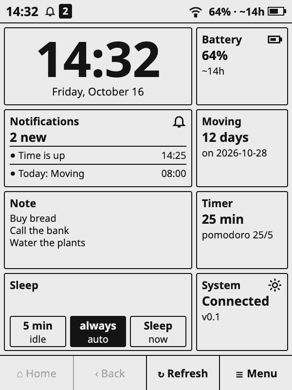
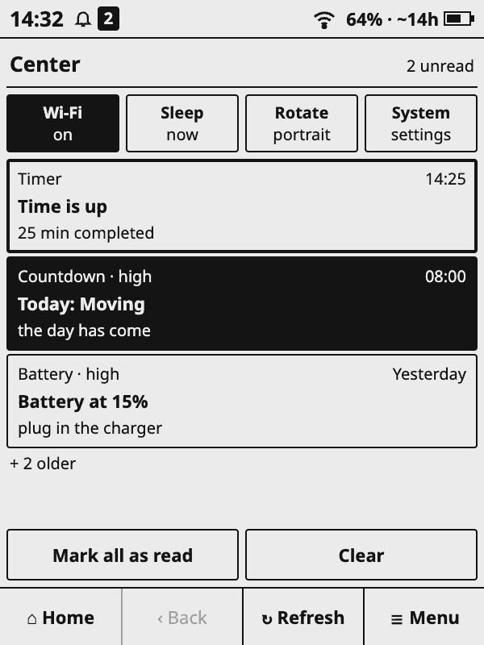
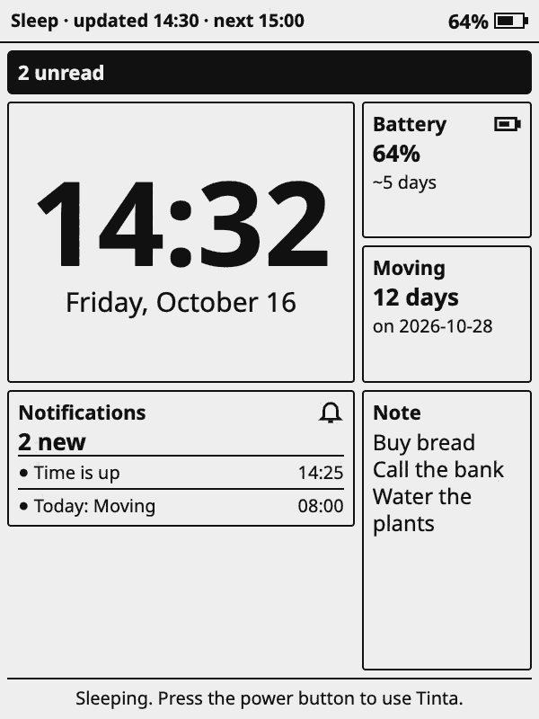
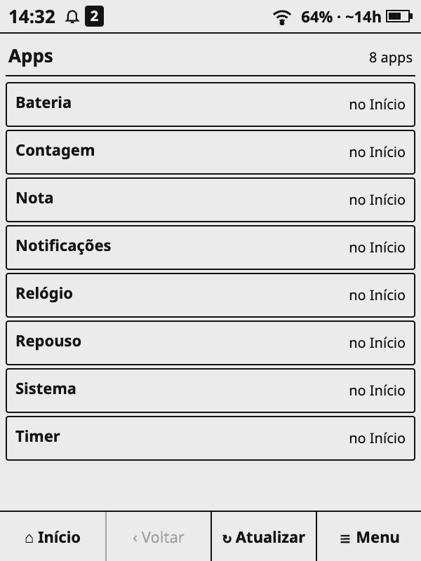
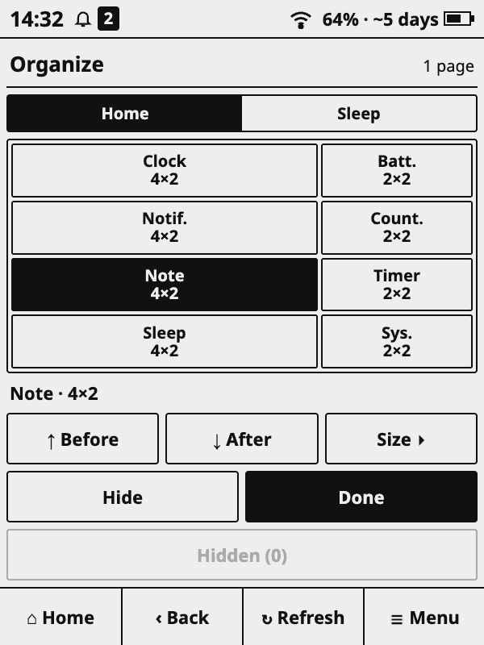
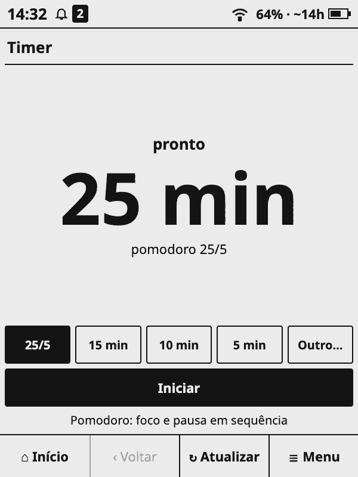
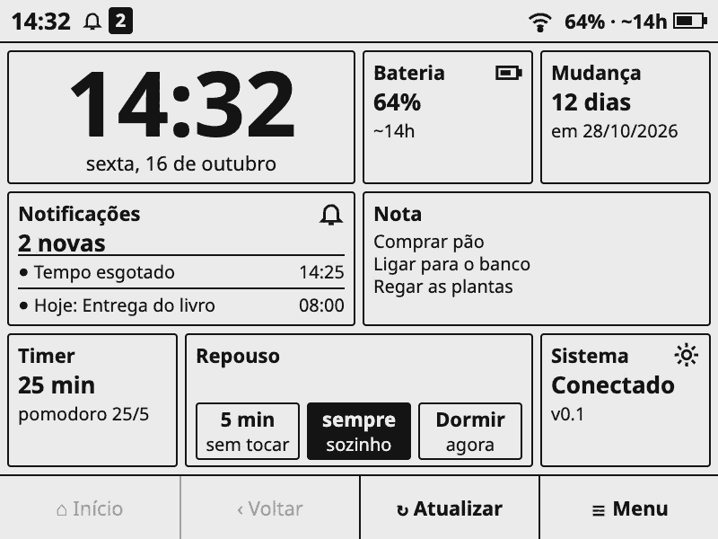
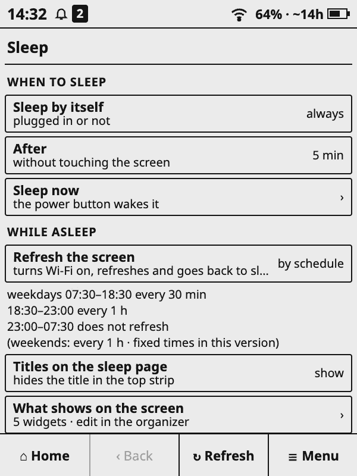
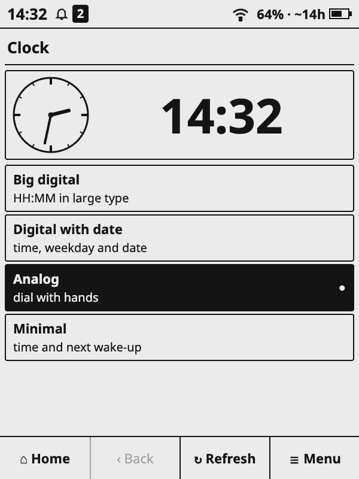
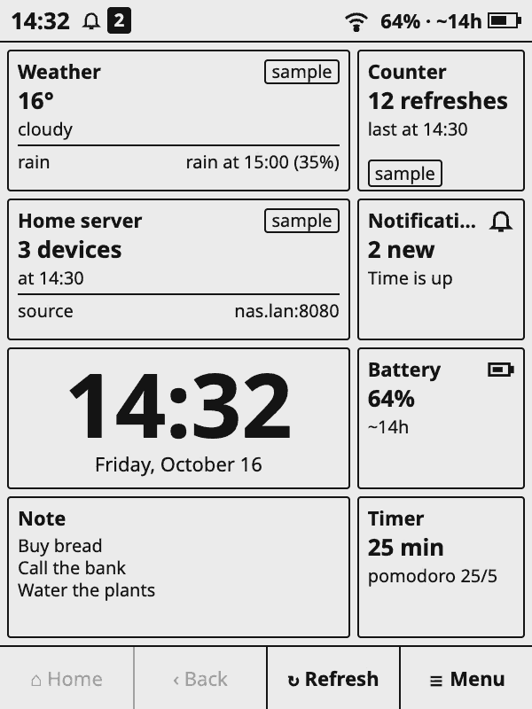

# Tinta for KOReader

**Tinta** is a [KOReader](https://koreader.rocks) plugin that turns an e-ink reader into an app dashboard: a home screen of widgets, a notification centre, per-app scheduled refresh over a single Wi-Fi connection, and a **sleep page** that stays on screen while the device sleeps and wakes on its clock only to refresh. It is a platform on top of KOReader (which already handles the screen, touch, Wi-Fi and suspend), not an operating system. Black and white, no animations, built for e-ink.

**Tinta is a platform: you can build your own apps for the dashboard.** An app is a small Lua folder that gets notifications, scheduling, settings screens, storage, network and widgets from Tinta, so you write only what is specific to your app. See [Build your own apps](#build-your-own-apps).

Built for and tested on a **Kindle Basic 2 (KT3)**. Status: under active development; Kobo support is **experimental**.

<p>



</p>
<p>



</p>
<p>



</p>

(The screenshots come from the HTML prototype, [`docs/tinta-prototipo.html`](docs/tinta-prototipo.html), with made-up content.)

## Build your own apps

Tinta is meant to be extended. Everything on the dashboard, from the clock to the notification centre, is an app, and **you can write your own** in a few dozen lines of Lua (the language of KOReader's plugins). Tinta does the hard parts on an e-ink device, so your app only says what to fetch, what to show and when to speak up.

<p>

</p>

*Home with the three sample apps (tagged "sample"; made-up values).*

**What your app gets from Tinta**

| | |
|---|---|
| **Notifications** | A banner on screen, a notification centre, priorities (high / normal / off, chosen by the user per type) and de-duplication by key, so "rain today" fires once, not every refresh |
| **Scheduler** | Per-app refresh intervals and time windows; every app that is due shares **one Wi-Fi connection** (Tinta turns Wi-Fi on, runs them all, turns it off) |
| **Wake the sleeping device** | `ctx.wake_at(time)` wakes the Kindle from sleep at a time you choose (alarms, timers, countdowns) |
| **Settings screens** | Declare the fields (text, URL, number, choice, time, switch, **secret/token**) and Tinta generates the screen, with validation; secrets are masked, never shown, logged or exported |
| **Storage** | Per-app persistent data and a cache of the last good result (so widgets show something offline) |
| **Keyboard** | `ctx.input` opens KOReader's keyboard |
| **Network** | `ctx.net.get_json` / `post_json` with timeouts, a size limit and typed errors (`unreachable`, `unauthorized`, `not_found`, …) |
| **Widgets** | Home-screen widgets in several sizes (1×1, 2×2, 4×2, 2×4, 4×4) drawn with the scaled theme, so they fit any screen size; the same widget can go on the sleep page |
| **Sleep page** | The page that stays on screen while the device sleeps shows your widgets too |
| **i18n** | Portuguese and English texts per app, picked by the user's language |

**Three kinds of apps, three examples** (all in [`tinta.koplugin/apps/`](tinta.koplugin/apps); the folders start with `_`, so they load only with the `dev_apps` setting and are not in the release zip):

| Kind | Example | What it shows |
|---|---|---|
| **Local app** (no network): timers, notes, counters | [`_modelo`](tinta.koplugin/apps/_modelo) | The smallest complete app: a counter with a widget, a screen, a setting and a notification. `scripts/nova-app.sh <id> "<Name>"` copies it |
| **Talks to your home server** | [`_exemplo_json`](tinta.koplugin/apps/_exemplo_json) | Fetches a JSON from a URL you set (with an optional token), shows a value, notifies when it crosses a threshold |
| **Uses a web service** | [`_exemplo_clima`](tinta.koplugin/apps/_exemplo_clima) | Current weather and the next hours from the public [Open-Meteo](https://open-meteo.com) API (no key): latitude, longitude and units as settings, refresh every 30 min, widgets 2×2 and 4×2, a screen with the next hours, and "rain in the next hours" notified once per day |

Each example is pure logic (`logic.lua`) plus drawing, strings and tests, and the network ones are tested with a **fake `ctx.net`**, so you can develop and test without a device or a network.

```sh
scripts/nova-app.sh weather "Weather"        # a new app from the template
luajit tinta.koplugin/apps/weather/tests/run.lua
scripts/deploy.sh --app tinta.koplugin/apps/weather --ssh <ip>   # to koreader/tinta-apps/ (or copy by USB)
```

- **Read the [SDK guide](docs/sdk.md)** (manifest, `ctx` API, widget sizes, theme, notifications, performance rules, testing, checklist).
- **Give [`AGENTS.md`](AGENTS.md) to your coding agent**: it describes the repository, how to build and test, and the hard rules a Tinta app must follow, so an AI assistant can write an app for you and check its own work with `scripts/test-all.sh`.
- **Be honest about trust:** apps are Lua running **inside the KOReader process with full access** (files, network, the device). The permissions in a manifest inform the user, they do not enforce anything. Only install apps you trust, and read the code of any you did not write.

## Supported devices

| Device | Status | Sleep and wake |
|---|---|---|
| Kindle Basic 2 (KT3, 600×800) with KOReader | **Tested** | Complete: suspends and wakes on the clock (RTC through `powerd`) |
| Other Kindles with KOReader | Should work, **untested** | Same as the KT3 if the device accepts `rtcWakeup` |
| Kobo with KOReader | **Experimental, untested on hardware** | Uses KOReader's own suspend and RTC wake-up support, if the device has it |
| Other touch devices with KOReader | Generic backend, untested | **No scheduled wake-up**: the sleep page shows, but the device does not wake by itself to refresh |

The interface is designed for 600×800 and scaled by `s = min(W/600, H/800)` (letterboxed when the ratio differs); on the KT3 `s = 1`, so nothing changes. Only touch devices are targets.

## Install

1. Install KOReader on the device (on a Kindle this needs a jailbreak; see the [KOReader wiki](https://github.com/koreader/koreader/wiki)) and check that it opens.
2. Download `tinta-<version>.zip` from the [Releases](../../releases) page and unzip it. It contains the folder `tinta.koplugin`.
3. Copy `tinta.koplugin` into `koreader/plugins/` on the device (USB, or SSH with `scripts/deploy.sh --ssh <ip>` from a clone of this repository).
4. **Restart KOReader.** Tinta appears in KOReader's main menu.

**Your own apps, outside the plugin:** put each one in `koreader/tinta-apps/<id>/` (`scripts/deploy.sh --app path/to/<id> --ssh <ip>`, or copy by USB). They survive plugin updates. See [`docs/sdk.md`](docs/sdk.md).

## First steps

1. Open Tinta from the KOReader menu. A first-run wizard asks for the language, Wi-Fi and which apps go on Home.
2. **Menu → Apps** lists every app (hidden ones too). Tap opens; hold adds it to Home. Hold a widget on Home to open the organizer.
3. Apps that talk to a server ask for its address in the app's own settings (**System → Apps → (app)**).
4. **System** shows battery, Wi-Fi, version, stored data and the sleep options. **System → Data** exports a diagnostic and a settings backup (never tokens or passwords).

## Bundled apps

| App | What it does |
|---|---|
| Battery (`bateria`) | Battery log (CSV), chart and two estimates of the time left: at your recent real pace, sleep included (e.g. `~5 d`), and awake with Wi-Fi (e.g. `~14 h`) |
| Clock (`relogio`) | Clock for Home and for the sleep page (several styles) |
| Sleep (`repouso`) | The page shown while the device sleeps |
| Notifications (`notificacoes`) | Notification centre for all apps |
| Timer, Countdown, Quick note (`timer`, `contagem`, `nota`) | Simple utilities |
| System (`sistema`) | Device information, data, logs and Tinta settings |

Apps whose folder starts with `_` (`_modelo`, `_exemplo_json`, `_exemplo_clima`, `_test_*`) are references and test fixtures; they only load with the `dev_apps` setting.

## Writing an app

The full picture is in [Build your own apps](#build-your-own-apps) above. The short version: read the [SDK guide](docs/sdk.md) (in Portuguese, with an English summary on top) and run:

```sh
scripts/nova-app.sh weather "Weather"       # copies tinta.koplugin/apps/_modelo to apps/weather
luajit tinta.koplugin/apps/weather/tests/run.lua
```

Three reference apps: `_modelo` (a local counter), `_exemplo_json` (your own server: fetches a JSON from a URL, shows a value, notifies when it crosses a threshold) and `_exemplo_clima` (a web service: weather from Open-Meteo). The network ones are tested with a fake network.

## How sleep works

- **Kindle:** to sleep, Tinta turns off `preventScreenSaver`, presses the power button by software, schedules the wake-up with `rtcWakeup` (asked again every 2 s until `powerd` accepts) and suspends. On a clock wake-up it turns Wi-Fi on only if an app on the sleep page needs it, refreshes, redraws, turns Wi-Fi off and lets `powerd` suspend again. The power button goes back to normal use. With a **USB cable** the Kindle does not suspend; Tinta follows the same schedule without suspending.
- **Kobo (experimental):** uses KOReader's suspend and RTC support.
- **Generic:** no scheduled wake-up.
- Default "by time of day" schedule: weekdays 07:30–18:30 every 30 min, 18:30–23:00 every 60 min, no wake-ups from 23:00 to 07:30. Also 15 min / 30 min / 1 h / 2 h and "never".

Measured on the KT3: about 48 mA awake with Wi-Fi and Tinta open (roughly 20–22 h), about 4–5 mA suspended, about 1 mAh per scheduled wake-up with Wi-Fi. Other devices can differ a lot.

## Privacy and security

- **Apps run inside the KOReader process with full access** (files, network, the device). Manifest permissions **inform, they do not enforce**. Install only apps you trust.
- Tokens and secrets are never shown or logged; apps keep only the fields they need, not the raw server response.
- The sleep page is visible while the device sleeps. Apps marked `sensitive` start hidden there, and notification titles can be hidden (System → Sleep).
- Servers of your apps that have no authentication should stay on your local network.

## Reporting problems

Open an issue (there is a template) and attach, **after checking there are no secrets**: the diagnostic exported by **System → Data**, `koreader/crash.log` and `koreader/tinta-power.log` if relevant, plus the device model, the KOReader version and the Tinta version. `scripts/pull-logs.sh` fetches the logs over SSH or USB.

## Development

```sh
scripts/test-all.sh                          # every suite (needs luajit)
KOREADER_REF=<KOReader sources> scripts/test-all.sh    # also the store tests against KOReader's real SQLite binding
```

| Where | What |
|---|---|
| [`AGENTS.md`](AGENTS.md) | Repository guide for contributors and AI coding agents: layout, build, hard rules, PR checklist |
| [`CONTRIBUTING.md`](CONTRIBUTING.md) | How to contribute (pt/en) |
| [`docs/sdk.md`](docs/sdk.md) | Writing apps |
| [`docs/arquitetura.md`](docs/arquitetura.md) | Architecture and the numbered rules (`R-…`) cited in the code |
| [`docs/plataforma.md`](docs/plataforma.md) | Platform decisions and status |
| `scripts/` | `test-all.sh`, `nova-app.sh`, `deploy.sh`, `pull-logs.sh`, `build-release.sh` |

## License

[GNU AGPL-3.0](LICENSE), the same license as KOReader.

---

# Português

**Tinta** é um plugin do [KOReader](https://koreader.rocks) que transforma um leitor e-ink num painel de apps: tela inicial com widgets, central de notificações, atualização por app com uma única conexão Wi-Fi e uma **página de repouso** que fica na tela enquanto o aparelho dorme, acordando pelo relógio só para atualizar. Testado só num **Kindle Basic 2 (KT3)**; outros Kindles devem funcionar (não testado), **Kobo é experimental** e os demais aparelhos têm um backend genérico, sem despertar programado.

**Instalar:** baixe `tinta-<versão>.zip` em [Releases](../../releases), descompacte e copie a pasta `tinta.koplugin` para `koreader/plugins/` do aparelho; reinicie o KOReader. Apps suas ficam em `koreader/tinta-apps/<id>/` e sobrevivem às atualizações do plugin.

**A Tinta é uma plataforma: construa as suas próprias apps para o painel.** Uma app é uma pasta Lua pequena; a Tinta dá notificações (banner, central, prioridades, sem repetição), agendamento com um único Wi-Fi compartilhado, acordar o aparelho dormindo numa hora (`ctx.wake_at`), telas de configuração geradas (com validação e campos secretos), armazenamento e cache por app, teclado, rede com timeout (`ctx.net`), a página de repouso, widgets em vários tamanhos com o tema escalado e i18n. Há três tipos de app, cada um com um exemplo: **locais** (`apps/_modelo`), que **falam com o seu servidor** (`apps/_exemplo_json`) e que **usam serviços da web** (`apps/_exemplo_clima`, tempo pela API pública Open-Meteo). Leia o [`docs/sdk.md`](docs/sdk.md) e **entregue o [`AGENTS.md`](AGENTS.md) ao seu agente de código**. Atenção: as apps rodam no processo do KOReader com acesso total.

**Escrever uma app:** [`docs/sdk.md`](docs/sdk.md) e `scripts/nova-app.sh <id> "<Nome>"`. **Contribuir:** [`CONTRIBUTING.md`](CONTRIBUTING.md) e [`AGENTS.md`](AGENTS.md). **Testes:** `scripts/test-all.sh` (precisa de `luajit`). **Arquitetura e regras:** [`docs/arquitetura.md`](docs/arquitetura.md).

**Segurança:** as apps rodam no mesmo processo do KOReader, com acesso total; as permissões do manifesto informam, não impedem. Instale só apps em que confia. Tokens nunca são exibidos nem registrados em log.

**Reportar problemas:** abra uma issue e anexe o diagnóstico exportado em **Sistema → Dados** (sem segredos), a versão da Tinta e do KOReader e o modelo do aparelho.

Licença: [AGPL-3.0](LICENSE).
